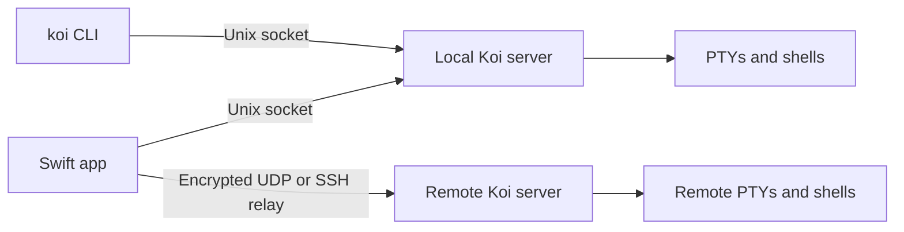

# Architecture

Koi is split into two main layers:

- The `src/core` code owns the terminal server, PTYs, transport, and pane lifecycle.
- The `src/app` code owns the Mac UI, settings, window state, and user-facing workspaces.

Both sides talk through a versioned wire protocol so the UI can attach to servers without owning the processes themselves.

## Core responsibilities

The Zig server is the authority for shell state. It:

- starts and owns PTYs and child processes
- tracks panes, tabs, groups, and split layouts
- stores session metadata and transport state
- provides snapshots and control commands to clients
- keeps the server alive independently of any individual app window

The important files are:

- `src/core/server.zig` — server lifecycle and state management
- `src/core/pane.zig` — pane lifecycle, terminal state, and PTY handling
- `src/core/pty.zig` — PTY startup and process launch
- `src/core/remote.zig` — remote machine offer and SSH relay flow
- `src/core/wire.zig` — wire protocol definitions and framing
- `src/core/paths.zig` — private runtime and state directories

## App responsibilities

The Swift app is the presentation layer. It:

- owns windows, tabs, pane selection, and split UI
- attaches to server state through sockets and transport streams
- renders terminal content with libghostty-vt and Metal
- stores configuration and project layout settings
- schedules activity and connection recovery

Key files:

- `src/app/app.swift` — app and window lifecycle
- `src/app/workspace.swift` — workspace and selection state
- `src/app/terminal.swift` — terminal view and interaction layers
- `src/app/renderer.swift` — renderer integration and diagnostics
- `src/app/remote.swift` — SSH installation and remote-connect logic
- `src/app/wire.swift` — app-side wire representation
- `src/app/config.swift` and `src/app/settings.swift` — user settings and validation

## Ownership and session model

A server starts on demand and continues running even when the last client detaches. Shells remain alive until the server exits or a pane is explicitly closed.

This model intentionally separates:

- terminal ownership from the UI
- process lifetime from client lifetime
- app state from server state

The result is that multiple windows can attach to the same live session and reopen the same server state without restarting the shell processes.

## Transport and protocol

Koi supports local Unix sockets, encrypted UDP links, and SSH-based relays. Remote setup installs a matching server binary on the target machine, proves the binary hash, then connects over UDP when possible and falls back to SSH stdio if necessary.

The protocol is versioned and checked on both sides:

- `src/core/wire.zig` — protocol and framing definitions on the server side
- `src/app/wire.swift` — client-side representation and decoding

When the protocol changes, both files must remain compatible with the intended version bump. Socket names include the protocol version so incompatible clients do not accidentally attach to the wrong server.

## Capability model

The server advertises capabilities such as:

- `serverInfo`
- `clearPane`
- `resetPane`
- `configurePane`
- `startup`
- `reportStatus`
- `splitCwd`
- `resizeSplitWeights`
- `paneControl`
- `ownedCommands`

These are additive and checked by clients before they rely on newer behavior. Older servers continue to work as long as the client does not require a newer capability.

## Observing and controlling panes

Koi distinguishes between observing and owning a pane. Observers can view output but do not send terminal input or resize commands. A client can explicitly take control when the server permits it. This allows Koi to keep remote work visible without granting accidental input control.

Ownership and control checks run at the server layer, which keeps a pane's actual process lifecycle under one authority.

## Diagnostics and recovery

The app keeps diagnostics for recent render issues, local connection state, and remote endpoint health. When a pane or control connection is lost, the client retries with backoff and reattaches by pane ID when the server remains alive.

This gives Koi a resilient reconnect model without restarting or recreating shells during transient network or transport interruptions.

## Where to look when changing code

If you need to understand a feature, start in the closest layer:

- server behavior: `src/core/*.zig`
- UI and workspace behavior: `src/app/*.swift`
- protocol changes: both `src/core/wire.zig` and `src/app/wire.swift`
- environment and runtime paths: `src/core/paths.zig`
- remote setup and link fallback: `src/app/remote.swift` and `src/core/remote.zig`

The repository keeps a flat organization by responsibility rather than introducing large abstraction layers for every helper.

## Runtime contracts

The [implementation reference](implementation.md) retains the detailed ownership,
wire compatibility, rendering and storage contracts. Runtime sockets and locks
use a platform path derived from the user, independent of `TMPDIR` and
`XDG_RUNTIME_DIR`; `KOI_DIR` overrides it for isolated development and tests.
Moving that path is a migration because existing servers stay at the old path.

The server refuses new panes at 128 and connections at 1024. Its log rotates at
8 MiB; this is a periodic threshold, not a hard disk-space bound. SSH relays
consume keepalive frames and expire after 75 seconds of silence once armed.

Updates use Sparkle with signed archives and a signed appcast; Koid does not
check for updates. Agent hooks are an explicit opt-in. `koi api` describes the
wire vocabulary, while `koi do` and `koi run` script CLI operations with Lua.
See [CLI](cli.md) and [configuration](configuration.md) for those interfaces.
