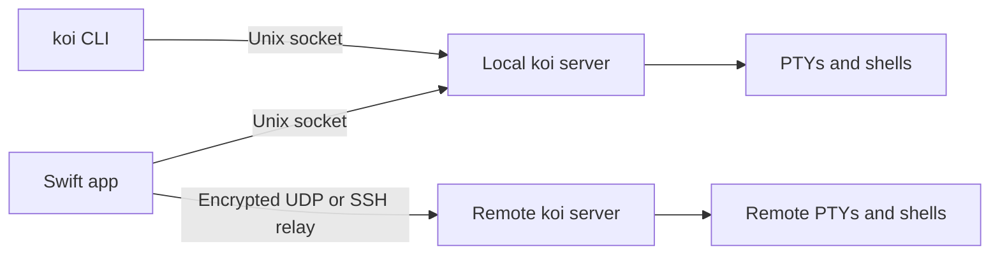

# Implementation reference

Koi separates terminal ownership from the Mac interface. A Zig server owns
the PTYs and processes; the Swift app attaches to them. The same `koi`
executable provides the server and CLI, while `libkoi` exposes the remote
link client to Swift.

## Session lifecycle

The server starts on demand and runs independently of the app. Detaching or
quitting a client leaves shells running. The server retains terminal state
and scrollback and supplies a snapshot when a pane attaches. A server
restart ends its processes. Automatic layout metadata describes existing
sessions; explicitly opening a named project recipe creates fresh shells.

Explicitly closing a pane, tab or group removes it from the visible tree
before child teardown finishes. The pane's reader handles hangup and bounded
escalation separately, retaining the child and pane until cleanup is safe.
Closing a tab therefore does not wait for its shell to exit. PTY EOF also
removes the pane before child cleanup, so normal exit avoids that wait too.

The app mirrors each attached pane in its own libghostty-vt terminal. Core
Text supplies glyphs and Metal draws them. AppKit owns the window, terminal
views and input integration; SwiftUI supplies tab bars, headers and floating
controls. Each window owns its selection, focus, workspace connections and
terminal mirrors independently while attaching to the same servers and shared tab
tree. Closing one client detaches only its connections and preserves jobs.
The application owner shares activity tracking and the project catalog.

The main entry points are [`server.zig`](../src/core/server.zig),
[`workspace.swift`](../src/app/workspace.swift),
[`terminal.swift`](../src/app/terminal.swift) and
[`renderer.swift`](../src/app/renderer.swift).

Source is flat under `src/app/` and `src/core/`; follow feature ownership
rather than adding a layer for each helper. Useful boundaries are:

| Responsibility | Sources |
| --- | --- |
| Window ownership, workspace selection, tabs and pane presentation | [`app.swift`](../src/app/app.swift), [`window.swift`](../src/app/window.swift), [`workspace.swift`](../src/app/workspace.swift), [`tabs.swift`](../src/app/tabs.swift), [`panes.swift`](../src/app/panes.swift) |
| Connection lifecycle and routing | [`connections.swift`](../src/app/connections.swift), [`transport.swift`](../src/app/transport.swift), [`endpoint.swift`](../src/app/endpoint.swift), [`remote.swift`](../src/app/remote.swift) |
| Configuration, Settings and fixed palette | [`config.swift`](../src/app/config.swift), [`settings.swift`](../src/app/settings.swift), [`theme.swift`](../src/app/theme.swift) |
| Project recipes and current activity | [`projects.swift`](../src/app/projects.swift), [`activity.swift`](../src/app/activity.swift) |
| Running-server facts and support | [`server.swift`](../src/app/server.swift), [`updater.swift`](../src/app/updater.swift), [`diagnostics.swift`](../src/app/diagnostics.swift), [`diagnosticswindow.swift`](../src/app/diagnosticswindow.swift) |
| Scripting (`koi do`, `koi run`) | [`script.zig`](../src/core/script.zig), [`prelude.lua`](../src/core/prelude.lua) |
| Terminal text accessibility and opt-in installation | [`accessibility.swift`](../src/app/accessibility.swift), [`install.swift`](../src/app/install.swift), [`integrations.swift`](../src/app/integrations.swift) |
| Storage and development previews | [`layout.swift`](../src/app/layout.swift), [`paths.swift`](../src/app/paths.swift), [`koid.swift`](../src/app/koid.swift) |

## Connections and protocol

Control connections watch tabs/groups and issue commands. Pane connections
attach by pane ID and carry snapshots, output, input and resize events.
The wire definitions in [`wire.zig`](../src/core/wire.zig) and
[`wire.swift`](../src/app/wire.swift) must agree on framing, message kinds,
payloads and protocol version. Their source text is language-specific.
Incompatible changes require updating the version on both sides. Socket
names include that version so incompatible clients use separate sockets.

The current protocol remains **v6**. New control operations and fields are
additive JSON; they do not extend the `libkoi` C ABI. `serverInfo` returns
`serverVersion`, `serverPID`, `protocolVersion`, `uptimeSeconds`, `transports`,
`capabilities`, `layoutFormat` and `snapshotFormat` from the answering process. The version is the package
version plus a digest of the core sources, computed by `scripts/build-core.sh`
and stamped into the binary (`koi version` prints it), so replacing a binary
on disk does not change the identity of a server already running, and the
app can tell when the local server predates the build it carries.

The app also reads the earlier v6 binary split layout (`first`, `second`,
`ratio`) as two weighted children. It preserves split IDs and nesting so
existing remote panes and divider resizing work without a server restart.
Current servers and newly encoded layouts use `children` with relative weights.
CLI target lookup reads only tab IDs and pane metadata, skipping layouts so
commands can still resolve existing panes on either generation of v6 server.

Clients must require an explicit capability before using an additive option:
older v6 servers can ignore unknown JSON fields. Unsupported features are
reported or disabled without replacing the server or ending its sessions.
Existing commands continue to work without the new options.

| Capability | Control contract |
| --- | --- |
| `serverInfo` | Read-only server identity and supported features |
| `clearPane` | Erase history while preserving screen, modes and parser |
| `resetPane` | Replace engine state, preserving process/PTY, size and configured defaults |
| `configurePane` | Apply default foreground/background/cursor colors and history budget; creation also accepts `appearance` |
| `startup` | `newTab`/`splitPane` accept shell source in `startup`, passed intact to the login shell with `-c` |
| `reportStatus` | Set an exact pane's foreground-program status without terminal output |
| `splitCwd` | `splitPane` honors explicit `cwd` rather than silently inheriting |
| `resizeSplitWeights` | `resizeSplit` accepts a full positive finite `weights` array, normalized per child, mutually exclusive with `ratio`/`index` |
| `paneControl` | Open may negotiate explicit resize/input ownership and attachment errors; legacy clients receive no new frame kinds |
| `ownedCommands` | A logical `controller` ID binds pane attachments to ownership-checked control commands |

Pane connections ask for server information on their own stream before opening.
Explicitly unsupported wire, layout or snapshot formats fail before attachment;
older v6 servers without these fields remain readable. Layout formats are
`weighted-v1` and `binary-v1`; the current snapshot format is `ghostty-vt-v1`.
Unknown or malformed control state is reported rather than silently discarded.

An open with `paneControl: true` opts into `ownership` (72, one-byte Boolean)
and `failure` (73, JSON error) responses. `paneControl` (9, one-byte claim/release)
transfers ownership explicitly. The first non-observing, sized client may own
an unclaimed pane; a second attachment cannot steal its PTY size. Disconnecting
an owner never promotes observers. A legacy interactive client may reacquire an
unowned pane by resizing, but cannot replace a current owner. Zero-grid CLI
watchers do not claim ownership merely by attaching; legacy CLI input/close
remain explicit operations. Ownership changes discard held startup input from
the former owner. Ordinary detach never ends a shell.

Each workspace shares a random controller ID between its pane attachments and
control commands. Commands carrying that ID check current ownership at commit:
close checks every target before unlinking or signaling any process, and
terminal edits check under the pane mutex. Newly created panes reserve control
for their creator until an interactive client first takes ownership, so project
recipes can finish before views attach. Legacy CLI commands omit this proof
and retain their explicit behavior; it coordinates clients of the same user
and is not an authentication boundary.

Koid observes remote panes by default. Older remote servers also open passively
because they cannot enforce ownership. Observers send no terminal input, focus
reports, resizes or automatic engine configuration. Workspace close, split,
resize and terminal-edit commands also reject affected observing panes.
**Take Control of Pane** in
the command palette enables interaction; **Observe Pane** relinquishes it.
Legacy control is enforced only by this client. **Reconnect Pane** obtains a
fresh snapshot without sending shell input or restarting the process.

Only an actual child-exit event reports `Ended`. Attachment, compatibility and
snapshot errors preserve the last valid screen and use bounded reconnects.
Initialization expires after eight seconds without received bytes; partial
snapshots extend that deadline. Backoff resets only after a valid snapshot or
control state, never merely after opening a transport.

Clear, reset and configure prepare a replacement engine and bounded snapshot
before committing, then broadcast that snapshot to attached mirrors. Failure
leaves the authoritative engine unchanged. They do not send shell commands
or change PTY termios. Configure retains program OSC color overrides until
reset. Startup children remain gated through allocation, reader preparation
and tree publication; rejection does not execute the requested source. A pane
created by a client that sizes its panes (the app) stays gated until that
client attaches with the pane's real grid, or for one second, so the shell
draws its prompt once at the final size; CLI-created panes start at once.
Typed input is held by the server until the program takes the terminal, that
is turns off its line editing or echo as a shell's line editor does, or for
at most two seconds, so keys pressed while a shell starts are shown once by
the shell rather than echoed raw above its prompt and then again. Process
discovery ignores the child while it still carries the server's own image
between fork and exec, so a header never names the server as the program.
Shells the app bundle carries integration for (zsh through a Koi-owned
`ZDOTDIR` whose startup files run the user's own, fish through a vendor
configuration on `XDG_DATA_DIRS`) name each command themselves (OSC 7502 at
preexec, cleared by the OSC 133 prompt markers); that name is the program
until the prompt returns, and discovery then only tracks the directory.
Shell reports use the engine's streaming OSC callbacks, so command and prompt
markers remain ordered even when split across PTY reads.
The workspace accepts program changes immediately for input and activity.
Tab and pane captions wait briefly before displaying a new program, so
short commands do not flash; returning to the shell is immediate.
Servers installed on remote machines carry no integration files, so there
discovery alone names programs. The app reads its bundled server's version at launch and reports
in Diagnostics and the machine picker when the running local server is
another build.

JSON `appearance` remains independent of app configuration: the CLI protocol
still accepts foreground, background and cursor colors. The app supplies its
fixed palette and configured history budget through `Wire.Appearance`.
JSON colors are six hex digits without `#`; `scrollbackMB` defaults to 32 and
accepts 0–1024, with zero disabling history. Public config
and Settings deliberately cap the range at 1–32 MiB for reliable reattachment,
with the same 32 MiB default. These are engine page estimates, not
hard total-memory or cross-client privacy guarantees. Old mirrors can impose
their own 32 MiB default, and all snapshots still obey the 64 MiB frame cap.

For a remote machine, SSH installs the server under `~/.local/share/koi/koi`
and obtains connection details. The app then uses the encrypted UDP link,
falling back to the SSH stdio relay if UDP is unavailable. Silent UDP peers
expire after ten seconds, with three-second keepalives. Failed initialization
quarantines the matching cached link for thirty seconds without closing other
streams, allowing the failed connection to retry over SSH. While the relay
serves, the link is tried again every 30 seconds, except that a probe UDP
left unanswered is not repeated for ten minutes: each costs an SSH round
trip and a blocked port rarely opens within minutes. Bundled server
builds support Apple silicon macOS and x86_64 Linux. Setup commands have a
60-second deadline and retain at most 1 MiB each of stdout and stderr;
cancellation stops and reaps the local SSH process.

An SSH channel cannot tell its far end has vanished: a laptop that sleeps or
drops off the network leaves `koi --stdio` and its server connection running
on the remote machine, because SSH there may never report the loss. So the app
sends an empty `keepalive` frame every 20 seconds on each relay connection. The
relay swallows these, so the server never sees the kind, which an older one
would reject, and once it has seen one it exits after 75 seconds of silence
(three lost keepalives and slack). A peer that never sends one is never timed
out, so an older app behaves as before. The app only sends them through a relay
it installed itself, which the hash check in `prepare` guarantees. See
[`remote.swift`](../src/app/remote.swift) and
[`link.zig`](../src/core/link.zig) for the connection implementation.

[`deviceicons.swift`](../src/app/deviceicons.swift) identifies machine icons
independently of session setup. A background profiler lookup extracts only
the reported Mac model family; remote lookups use the existing SSH options,
and Linux uses a generic server symbol. Lookups time out after 15 seconds,
coalesce per endpoint, and retain a validated symbol in layout metadata for
offline display. Removed profiles and state-directory changes invalidate late
results. No server update or protocol change is needed; views only read the
cache. Tests inject probes and never launch hardware or SSH lookups.

The app retries a lost pane or control connection with a capped backoff, and
at once when the local server's socket directory changes or the network
path changes, so a restarted server or a returning network is not left
waiting out a timer.
A pane reattaches by ID and restores a fresh snapshot; a control connection
gets the current tree. Detaching a workspace cancels retries and closes its
connections. This recovers transport interruptions while the server remains
alive; restarting the server still ends its shells.

Endpoint connections and server startup run away from the main actor. Late
results after detach are closed rather than installed. A view without settled
geometry attaches with zero dimensions, which leaves the server's creation
size intact; animation resize holds postpone only resizing, never output.
Successful commands send the subscribed caller a current tree immediately;
other watchers retain the short metadata debounce.

Input and output schedule a coalesced foreground-process and directory
sample after a short delay, at most once per 100 ms. Idle panes retain a
500 ms fallback. Process discovery runs outside the pane mutex; a generation
check rejects results invalidated by new input, OSC directory reports or
close. OSC title, directory and status reports update metadata during parsing.

## Layout and presentation

Pane cards are cached by terminal identity across tabs and pruned against the
live workspace mirrors. Pane motion seats the destination grid before the
reveal, then moves position and opacity rather than scaling glyphs or resizing
the PTY on every animation tick. A new split slides out from the pane it was
split from, opaque throughout: a translucent card would show the glass behind
it as a flash. Tabs, new or switched to, show at once. A display-paced clock can
retarget from the installed position. The `animation` setting selects `snappy`
(the default, 180 ms), `natural` (260 ms) or `off`; `off` and system Reduce
Motion settle transitions directly.

Pane headers default to 42 points high with 8-point split gaps; `compact-panes`
uses 32-point headers and 4-point gaps. `show-pane-headers` controls visibility.
Focused and unfocused pane outlines are always neutral, without an accent-border
setting. `focus-follows-mouse` optionally focuses panes under the pointer;
`fade-inactive-panes` optionally dims inactive terminal content. Both default off.

Sidebar motion keeps the rail and header stationary while panes cover them,
including clipped, noninteractive native traffic lights. Its current
`PaneTransitionShell` is a temporary static background around the destination
live grids: it fills exposed bands, preserves gaps and absorbs filler clicks
without storing terminal pixels. The window clock owns its lifetime and
reversal. Interactive sidebar resizing uses its own terminal resize hold
until release.

`SettingsWindow` in `settings.swift` is a fixed-size glass window without
traffic lights. It closes on focus loss or Command-W and ignores zoom/fullscreen
actions. Blur dismissal waits until focus settles so attached sheets and modal
save dialogs can keep their initiating Settings window. Its categories
are Appearance (the default), Terminal, Shortcuts, Machines & Server, Activity
and Advanced. Terminal's Text group owns font family, size and line height;
Terminal also contains cursor and input/session controls. Appearance contains
opacity, reduced transparency, motion, tab placement, pane headers, compact
spacing and inactive-pane fading. Font actions belong to Terminal in shortcut
lists and the palette; Toggle Sidebar and tab placement belong to Appearance.
The horizontal strip supports mouse
dragging, native two-finger scrolling and bounded arrow buttons, with no
keyboard category handlers. Search spans
categories; committed values reload through the app coordinator, while
unsaved drafts remain local to the Settings view. See
[Configuration](configuration.md) for the user-facing controls.

Compact labeled controls use SwiftUI's native `Capsule` shape. Standalone
glyph buttons in the title bar, tabs and pane headers use circular hover
highlights, with square click areas retained for comfortable targeting.
Their hover fades honor motion off and system Reduce Motion.
[`buttons.swift`](../src/app/buttons.swift) defines `SelectionSurface`, the
shared backing for Settings and Diagnostics categories. Tabs and collapsed groups
containing the selected tab use `GlassTabSurface` in `tabs.swift`: horizontal
selection keeps a translucent fill and faint rim; vertical selection adds a
subtle gradient over material, honoring Reduce Transparency. Palette
fields and results, prompt buttons and shortcut recorders use the same shape.
It adds no layout or motion. `theme.swift` supplies the fixed dark glass palette:
background `17171b` and foreground/cursor `e6e6ea`. `config.swift` retains
background opacity (default 0.85), motion and pane preferences, persisted in
the config file. Windows use dark appearance; the `reduce-transparency` setting
or macOS Reduce Transparency selects solid backing.

Left, top and right tab strips share [`tabinput.swift`](../src/app/tabinput.swift).
A tab is selected on mouse-down, as native tab bars do, so a click switches
as immediately as a shortcut; the native click count on the second press
recognizes a double-click rename without putting a multi-click recognizer
around the close button. The second press renames the tab that took the
first, since selecting may have resized or scrolled the rows under the
pointer. While a name field is open the terminal stops reclaiming the
keyboard on pane updates; closing the field hands it back.
Context menus open on a right or Control click through one window-local
monitor per control ([`popover.swift`](../src/app/popover.swift)). Hit checks
use each anchor's bounds as well as its visible area, since unclipped native
anchors can report visibility across neighboring tabs. A press over another
control replaces the open menu. Scroll gestures that only
begin and end, as fingers settling for a physical trackpad press produce,
leave a menu open; actual travel dismisses it and scrolls what is beneath.
The selected horizontal tab grows to its natural title width, capped by the
viewport; inactive tabs keep their compact width. Rows and the glass indicator
share SwiftUI matched geometry and a selection spring. The indicator paints
outside the scroller so its bounce is not clipped at the first tab. Machine
changes reset that shared presentation. Structural changes and group collapse
use a short ease without overshoot. Vertical rows keep their own static
selection. Hover surfaces and close controls fade, with a reserved close slot
crossfading against vertical activity indicators. Rename fields crossfade over
captions that preserve layout; submitted names remain visible until matching
server state or rejection. Motion off and system Reduce Motion disable motion.
Rows stay in place during a drag; live target geometry provides an insertion
cue or highlights an existing group header. Release commits one move and
clears the gesture immediately. Escape cancels it. New groups are created
explicitly through the tab menu, while dropping on a named group joins it.
Vertical rails resize from their inner edge and share a saved width. Resizing
holds terminal dimensions until release so intermediate frames do not
repeatedly resize the shell.

Renderers share the immutable Metal device and pipeline. Per-pane engine
state and glyph atlases stay independent; unchanged font metrics survive
view reparenting. A failed drawable/presentation attempt retains its pending
frame for the next display tick; a failed GPU completion wakes the view to retry
the latest frame. Main-thread output deliveries are bounded to
256 KiB or 64 events, with indivisible snapshots allowed alone, so streaming
output yields between deliveries. The focused pane draws completed output the moment it
arrives instead of waiting for that tick, which is up to one frame less
between a keystroke and its echo; other panes draw on the tick. Remote panes
predict typing locally (see `echo.swift`): the predicted cell is drawn on the
keystroke itself, before the round trip, and reconciled with the real echo.
Unchanged blanks require cursor evidence; pending erases cover split echoes,
and unpredictable input or expiry clears the whole overlay and echo confidence.
Guesses stay hidden until a completed redraw demonstrates echo; program names
never bypass that check. Each pane's display link pauses once a tick
finds nothing to draw, and wakes on output, input, a gesture or the window
being uncovered, so idle panes cost no frames. A blank initial snapshot suppresses the
cursor until visible output or input, bounded at two seconds. A shell-reported
`clear` also holds the cursor while the cleared screen awaits its prompt, with
the same limit. Neither hold delays terminal output. Scrolled-back output is drawn as-is: the
renderer paints nothing over the top of the viewport, so the first visible
row of history is never dimmed or shadowed.

Ghostty's synchronous render-hold callback captures the completed image before
mode 2026 redraw bytes mutate it. The renderer holds that state across output
batches and consecutive redraws, releasing it on the end sequence or after one
second even without more output. A snapshot restored inside a hold keeps the
previous image, or blank backing on first attach, until release. Explicit local
scrolling/selection may interrupt a hold, following Ghostty's documented policy;
this avoids copying the terminal's history for each redraw. Cursor inversion
composites after ordinary text and predictions, uses the composed cell beneath
the caret, and follows cursor opacity.

## Diagnostics

[`diagnosticswindow.swift`](../src/app/diagnosticswindow.swift) owns the glass
window's horizontal Overview, Connections, Rendering and Recent Issues
sections. `app.swift` wires Help and palette actions, snapshot providers and
explicit probes to the invoking window. Endpoint inspection is independent
of active-session selection and never connects, attaches panes or starts
processes. Refresh uses an existing control connection. A 1 Hz timer samples
only while visible; close/minimize invalidates it, and Pause skips automatic
snapshot updates. Copy/export uses the inspected snapshot's report.

Renderer counters are lock-protected and polled rather than published per
frame. They count committed submissions, successful completions, failures
and retry deferrals, with pending/in-flight state and drawable dimensions.
CPU timing covers assembly through commit, including drawable waits; GPU
execution uses valid timestamps from successful command completions. Atlas
and vertex-buffer allocation bytes count each live resource once, including
replaced resources still in flight. These are terminal-renderer measurements;
they do not measure GPU utilization, total process memory, WindowServer
composition or sidebar animation. Counter reset preserves in-flight ownership.

`DiagnosticIssues` keeps up to 100 sanitized, deduplicated app summaries.
Recent Issues merges them with retained errors from live attached renderers
and displays the newest 100. Clear History clears app summaries and hides
renderer issues predating the clear without touching log files. Reports
exclude raw logs and terminal text; opening the local server log requires
the explicit Open Local Server Log action. Copy/export shares the redacted
report formatter. Only a validated `major.minor.patch+` version with a
64-digit lowercase hex hash bypasses token scrubbing in the server-version
field, and only when it contains no configured host alias.

## Terminal text and activity

App mirrors handle OSC 52 text clipboard writes through the engine callback,
after snapshot restoration. Only the keyboard-focused pane in the active window
may copy a complete UTF-8 text value up to 1 MiB to the Mac pasteboard.
A clear request writes empty text; primary and
selection destinations are unsupported. Terminal clipboard reads are not exposed. Local
Shift-drag selection and Cmd-C remain independent of application-owned mouse
selections.
The mirror uses the engine's OSC boundaries to accept only OSC 52 writes.
Kitty clipboard transactions remain unsupported: they need acknowledged
server/client routing before they can change a client's clipboard.

[`accessibility.swift`](../src/app/accessibility.swift) builds a read-only AX
text document lazily, using UTF-16 indices and physical terminal rows across
screen and history. It maps wide cells and graphemes, visible ranges, cursor
and actual selection endpoints rather than searching for matching text.
Terminal mutations invalidate the document; observed accessibility changes
coalesce at four batches per second. Rendering does not build this document.
IME marked text remains a separate `NSTextInputClient` document and AX queries
cannot commit or replace terminal input.

Activity merges connected workspace snapshots by endpoint and pane identity.
Explicit `agentReport` registration binds an opaque server session and numbered
runs to a freshly sampled foreground process group. Process names are display
hints only. Each pane retains 64 sequenced lifecycle events and a random epoch;
these survive watcher and main-thread state coalescing. Consumers baseline first
observations and new epochs, deduplicate sequence numbers, and silently baseline
journal gaps with a visible Activity warning. They never infer completion from
status snapshots. A completed process's last session/history remains available
after returning to the prompt, so a short-lived agent cannot erase its completion.

`status` is reported task state, `statusSource` is `agent`, `reported` or null,
and `outputActive` independently describes recent PTY output. Silence does not
change task state. Generic `reportStatus` and legacy OSC 7501 remain supported
but do not declare agent identity. The program catalog controls artwork only.
Agent completion records remain pane-scoped across windows, with small yellow
icon circles and actionable toasts for other machines. Notification delivery is
injected, opt-in and quiet while focused by default; permission is requested
only by explicit user action. Notification clicks resolve existing endpoints,
tabs and panes, never creating shells for stale targets.

Optional status hooks (`hooks.swift`, `agenthooks.zig`) use separate versioned
provider contracts. Installation proves configuration only; the runtime adapter
validates session/turn fields before reporting. Activity shows the server's last
accepted report. See [agent contracts and environment boundaries](agents.md).

## Ownership and memory limits

Swift uses ARC; Zig and the engine handles have explicit owners. There is
no tracing garbage collector. Each terminal owns its engine state, each
renderer frees its render-state helpers, and each selection gesture retains
its terminal until its tracked references have been freed.

The server bounds what a runaway or vanished client can cost. It refuses a
new tab or split once 128 panes exist, answering "too many panes: close some
first", and drops new connections once 1024 are open, logging the first
refusal each second. Both ceilings are soft: two requests arriving at the
limit may both pass. The log rolls to `server.log.1` when the server starts and
every few seconds while it runs. Rotation keeps one earlier file; bursts
between checks can exceed the threshold, so 16 MiB is not a hard bound.

The embedded native library leaves alternate signal-stack ownership with
the host application, including when the host runs under a sanitizer.

A Swift link stream retains its link. Closing a native stream wakes readers
but keeps its pointer valid; the application releases its ownership exactly
once after its callers finish. The server unregisters a connection from
panes and watcher lists before releasing it. A pane stays allocated until
its child has been reaped, tree removal has finished and no connection or
command holds a pin. Removing it from the visible tree alone does not free it.

Slow consumers apply backpressure or are disconnected instead of growing
queues indefinitely. The principal limits are:

| Resource | Limit |
| --- | --- |
| Protocol payload | 64 MiB |
| Terminal grid | 1,048,576 cells |
| Scrollback per terminal | Default 32 MiB of engine pages; public config 1–32 MiB, JSON 0–1,024 MiB; snapshot limits still apply |
| Pending pane events | 8 MiB or 1,024 events; one larger frame may occupy an otherwise empty batch |
| App socket writes | 128 MiB and 4,096 pending writes |
| App link writes awaiting the worker | 64 MiB and 4,096 pending writes per stream |
| Server socket backlog | 16 MiB plus the current frame |
| Remote unsent data | 64 MiB per stream |
| Remote receive window | 4 MiB per stream; out-of-order storage is also bounded |
| Unreclaimed remote streams | 128 per link |
| Retained closed-stream records | 4,096 per link |

Remote app writes run on an ordered worker per link; keyboard handling never
waits for the native link mutex or packet encryption. The transport rotates
between streams as congestion credit becomes available, so a bulk stream
cannot always take the next available slot.

An application must release closed remote streams; awaiting FIN completion
continues to consume a stream slot. When old closed-stream records are
trimmed, unknown older IDs are ignored, including exceptionally late first
packets. Established streams are retained. These are resource policies, not
a change to version 6 framing.

Glyph-atlas eviction creates a fresh texture so in-flight GPU commands keep
their texture. Frame assembly pins one atlas generation and retries eviction
once. If a visible set exceeds the fixed atlas capacity, excess glyphs are
omitted for that frame rather than using stale UVs or allocating unlimited
textures.

## Storage

Layout metadata is cached per state directory. Selection is shown before
persistence, and rapid saves coalesce onto a serial utility queue. App
termination flushes the latest values after earlier writes.

| Data | Default location |
| --- | --- |
| Configuration | `~/.config/koi/config` |
| Layout and machine metadata | `~/.local/state/koi/layout.json` |
| Named project recipes | `~/.local/state/koi/projects.json` |
| Server log | `~/.local/state/koi/server.log`, rolled to `server.log.1` at 8 MiB |
| Socket and server lock | macOS's per-user temporary directory + `/koi`, `/run/user/<uid>/koi` on Linux, or `/tmp/koi-<uid>` |
| macOS window preferences, palette recents and Sparkle's update schedule | The app's UserDefaults domain |

`XDG_CONFIG_HOME` and `XDG_STATE_HOME` override their respective
directories. The runtime directory depends on the user and platform, never on
`TMPDIR` or `XDG_RUNTIME_DIR`: the server lock inside it is what keeps one
server per user, so a client started from a GUI, a login shell or SSH must
compute the same path. Changing it strands any server still running at the
old path, and the next client starts a second one beside it, so a change is a
migration. `KOI_DIR` puts configuration,
state and runtime files together in one directory; it does not relocate
UserDefaults. Long socket paths move the runtime directory to
`/tmp/koi-<uid>`.

macOS attributes a permission prompt raised by a program in a pane to Koi,
not to the program. Koi therefore declares the camera, microphone, contacts,
calendars, location, photos and Apple Events entitlements in
`src/app/resources/Koi.entitlements`, which the hardened runtime of a
notarized release requires, and a matching usage description for each in
`Info.plist`, which macOS requires before it will show the prompt. Only the app
executable carries the entitlements; the bundled server does not.

The socket is what authorizes a client to read and drive panes, so its
directory is the security boundary. The app and server create the state and
runtime directories (and the SSH control directory) private to the user, and
refuse to use one that is not: it must be owned by this user with mode 0700
and not itself a symlink. Symlinks among its existing ancestors are resolved,
and every resolved ancestor must be owned by root or this user and writable by
no one else: a root-owned sticky directory such as `/tmp` is accepted, and on
Linux so is a directory of this user's writable by their own primary group,
which `umask 002` produces. Existing permissions are never repaired. The runtime directory is never `/tmp`
itself, and the server also accepts a connection only from a peer running as
the same user. A refusal appears as `cannot serve from …: UnsafeDirectory` in
the server log.

Project recipes whitelist names, directories, tab/group order, topology and
relative split weights, with fresh IDs on restore. The PTY launcher uses `/` if a saved directory cannot be entered.
Startup source is only an explicit per-pane recipe field; the app's save action does not infer it
from processes. Recipes contain no terminal snapshots or process backups.
Restore waits for watcher-confirmed topology and weights and selects the
first new tab only after success. Failure stops further work, preserves
existing jobs and leaves newly created tabs/helpers for inspection. The app
requires `splitCwd` and `resizeSplitWeights` before restoring a layout.

Support actions stay with their feature owners: updates (`updater.swift`)
check GitHub's signed appcast daily and show their steps as one toast, with
Sparkle doing the download, signature check and install;
diagnostics format allowlisted facts without reading logs, terminal contents
or raw config values. Copy and save-panel export use the same redacted
report. CLI and Codex/Claude skill installation
mutate files only from user clicks. See [Configuration](configuration.md)
and [CLI](cli.md) for their destinations and controls.

Koid uses `KOI_DIR=~/.local/state/koid` and a separate bundle identifier,
`com.fschrhunt.koid`, keeping its sessions and macOS preferences apart from
Koi. Its screenshot and UI-preview receivers are enabled by the `KOID`
compile flag and excluded from production builds. See
[Contributing](../CONTRIBUTING.md) for the development workflow.
